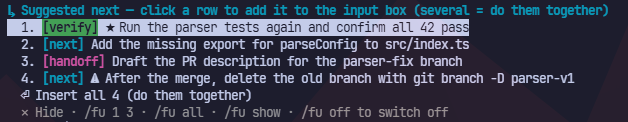

# followup-suggest

Version 2.0.5.

A [Claude Code](https://code.claude.com) mod that suggests what to ask next. After a substantial answer it shows 0 to 5
follow-up prompts in a band right above the input box. Click a row to add that prompt to your draft, review it, press
Enter. Nothing is ever sent for you.



```
↳ Suggested next — click a row to add it to the input box (several = do them together)
  1. [verify] ★ Run the tests for the parser change in /home/me/app/src/parser.ts
  2. [next] Add the missing error message for an empty config file
  ⏎ Insert all 2 (do them together)
  ✕ Hide · /fu 1 3 · /fu all · /fu show · /fu off to switch off
```

Claude Code's own dim prompt suggestion (accepted with Tab) keeps working; this mod does not replace it.

## How it works

- After each finished main-conversation turn whose answer is at least 60 characters long, the mod asks the session's
  own model, through a cached fork, for follow-up prompts. The fork sees the whole conversation, so it knows the task
  and the limits you set. If the fork cannot answer within 60 seconds, Haiku is asked instead; it sees only the end of
  the answer (3500 characters), your latest request and the matching commands.
- Silence is a normal result: explanations, factual answers and closed decisions get no menu.
- A menu that arrives after you already sent the next prompt, switched the mod off or ran `/fu forget` is discarded.
- Each row has a tag: **verify** (check or read back what was just produced), **next** (the smallest reversible next
  step), **handoff** (prepare a reviewable result) or **needs input** (the task is blocked on information only you have).
- Model output is treated as untrusted. Before a row is shown:
  - terminal escapes, control, bidi and invisible characters are stripped (also from menus restored from the store);
  - a row longer than 160 characters (file paths not counted) or 500 characters in all, or containing `...`, `…` or
    `[...]`, is dropped;
  - a row whose first two words include an action you forbade in one of your last 4 prompts ("do not run", "never push",
    "không push") is dropped;
  - a verify row naming a file path that does not exist is dropped (a path stops at the first space, so paths with
    spaces are not checked reliably);
  - a verify row is dropped when the turn that just finished already checked every file it names after its last edit.
    `Read`, `cat`, `type`, `Get-Content`, `head` and `tail` can establish content reads, not execution. A row asking to run
    or test needs a recognized runtime/test runner targeting that file. Simple `&&`, semicolon and newline clauses are
    checked separately; mere path mentions, pipelines, substitutions, redirections and unsupported syntax are not
    execution evidence. Directories, subagents' tool calls and earlier turns do not count;
  - a next or handoff row naming a file that your latest request does not mention is dropped as off-topic;
  - a row that repeats at least 80% of the words of one list item of the answer is dropped (rows under 4 words are kept);
  - a `/command` row is kept only if the session has that command.
- Rows that name a destructive, publishing or production action are **kept and marked with ⚠**, for example
  `2. [next] ⚠ Run git branch -D old-feature` (rows in `/fu log` carry the mark too). The check covers force push,
  `reset --hard`, `rm -rf` in any spelling, `Remove-Item -Recurse`, `git clean -f`, discarding uncommitted work
  (`git checkout -- .`, `git restore <path>`, `git stash drop|clear`), force branch deletes, pipe-to-shell (`curl … | sh`), `npm publish`,
  `gh pr merge`, `DROP TABLE`, `DELETE FROM`, `TRUNCATE`, `terraform destroy`, `kubectl delete` and production deploys.
  It is a word list, so a harmless row that only mentions these words can be marked too. The mark is display only: the
  text added to the input box has no mark, and Claude Code's permission prompts still apply when it runs. Whether such a
  step is suggested at all is left to the model rules (side effects only when you already asked for them).
- Rows can be skills or slash commands (for example `/code-review`): up to 25 non-built-in commands that match your
  request and the end of the answer are described to the model.
- Untagged lines from the model count as **next**.

## Install

Requires Claude Code with the mods API. Version 2.0.5 is tested on Claude Code 2.1.311 (also pinned in CI). On an older version without the
`model.fork` API the mod prints one notice and stays off for the session.

From the marketplace in this repository (this one command adds the marketplace and installs the plugin):

```
/plugin install followup-suggest --marketplace anhtahaylove/followup-suggest
```

Or try it for one session from a local clone:

```
claude --plugin-dir /path/to/followup-suggest
```

Check that it works: ask Claude for a small multi-step change (for example "create a file hello.txt and a test for it"),
wait for the answer, and a band should appear above the input box. A very short or self-contained answer gets no menu
by design. `/fu stats` shows how many suggestions were shown and used.

## Commands

| Command | What it does |
|---|---|
| `/fu` | Add row 1 to the input box (when a menu is shown) |
| `/fu 2`, `/fu 1 3`, `/fu all` | Add rows to the input box. A row the mod already added (✓) whose text is still in the box is skipped; text you typed yourself is not recognised. When every chosen row is skipped, nothing happens. Ranges are not supported (`/fu 1-3` adds row 1) |
| `/fu hide`, `/fu show` | Fold the band into one line, or open it again |
| `/fu log` | Show or hide the last 3 menus and what happened to each row: ➤ sent, ✎ inserted but changed or not sent, unused (30 are kept) |
| `/fu off`, `/fu on` | Switch the mod off or on for this session. Off also removes the menu on screen and discards one still being written; `on` does not bring it back. While off, no model call is made and your prompts are not recorded |
| `/fu lang en\|vi\|auto` | Pin the UI language, or follow your latest prompt (default). Applies to all sessions |
| `/fu rows 1-5\|auto` | Set the most rows a menu may have, or let the mod decide. Applies to all sessions |
| `/fu stats`, `/fu tune` | Usage numbers (the line ends with On. or Off.), and the automatic adjustments they caused |
| `/fu reset` | Clear the usage statistics, which also clears the automatic adjustments. Row limit and language are kept |
| `/fu forget` | Delete every stored menu, history and recent prompt, for all sessions. Statistics and settings are kept |

Clicking a row, the insert-all line or the folded line does the same as the matching command. Any other argument shows
the usage line while a menu is shown; without a menu `/fu` only says that there are no suggestions yet (or that the mod
is off).

Vietnamese aliases: `tắt` (off), `bật` (on), `ẩn` (hide), `hiện` (show), `lịch sử` (log), `thống kê` (stats),
`điều chỉnh` (tune), `dòng N|tự-động` (rows), `ngôn-ngữ` (lang), `quên` (forget), `tất cả` (all). A ✓ on a row means its
text is in the input box now: it goes away as soon as you clear the box or edit that text out, and after a resume or
reload the marks are checked against the box again. Usage is counted only once per row per menu, even if you clear,
reinsert or restore it. Saved menus from older versions use their saved check marks to seed this count.

`auto` language detection looks for letters that only Vietnamese uses; a Vietnamese prompt typed without diacritics is
read as English.

## Self-tuning

Statistics are kept across all sessions and do not decay. Once at least 20 suggestions were shown:

- a **next** or **handoff** tag that was shown at least 10 times and that you took less than 8% of the time is no longer
  offered. It stays hidden until `/fu reset`;
- if at least 15 picks were made and at least 85% of them were rows 1-2, menus are capped at 3 rows. Setting
  `/fu rows N` replaces this cap and takes effect even before 20 suggestions have been shown.

**verify** and **needs input** are never hidden. `/fu tune` explains what is active.

## Privacy and cost

- Everything stays on your machine, in Claude Code's plugin store (`~/.claude/plugins/store/`, JSON files named
  `followup-suggest_*.json`; installing from the marketplace and loading with `--plugin-dir` use different files, so
  statistics and settings do not carry over between the two). Nothing is sent anywhere except the model calls below.
- Per session the store keeps the current menu, the last 30 menus, and up to 4 recent prompts (at most 4000 characters
  in total, used to respect what you forbade). Oversized requests retain their first/last 1100 characters and up to 1600
  characters of detected constraint clauses. If these clauses overflow or cannot be represented by the local verb
  guard, the mod stays silent while that incomplete context remains in recent history, including after resume.
  The entire retained latest request anchors both the fork and fallback; constraint detection is heuristic, not a
  general natural-language permission system. Sessions are kept for 30 days, at most 100 of them. Usage statistics,
  the row limit and language choice have no time limit. `/fu forget` deletes the per-session data and invalidates
  pending menu work in the current session; it does not stop another already-running session from recording new data.
- Each answer of 60 characters or more costs one extra model call (a cached fork of your session), or two when the fork
  fails and Haiku is asked instead. The call is made before the filters, so a menu that ends up empty still costs it.
- Unattended runs (`claude -p`, scripts) make no model call and write nothing. With `FOLLOWUP_SUGGEST_DEBUG=1` they do
  call the model and add to the usage statistics, which can affect self-tuning; run `/fu reset` after debugging.

## Limitations

- The band needs an attached Claude Code surface; it does not appear in `claude -p` output.
- A home path (`~/x`) is not checked for existence.
- POSIX paths are recognised only under common roots (`/home`, `/Users`, `/tmp`, `/var`, `/etc`, `/opt`, `/usr`, `/mnt`,
  `/srv`, `/root`, `/private`, `/Volumes`, `/workspace(s)`) and msys drives (`/c/...`), and only with two more segments
  (`/home/me/app`) or a file extension (`/tmp/out.log`), so API routes such as `/api/users/1`, `/v/1` or
  `/home/dashboard` are not mistaken for files. Paths under other roots (for example `/app` in a container) and short
  paths without an extension (`/etc/hosts`) are not checked.
- When the mod's files change on disk, Claude Code reloads it and prints "followup-suggest: reloaded (6 hooks ...)".
  The current menu is restored from the store.

## Troubleshooting

- No band after an answer: the answer may have been short or self-contained (silence is intended). `/fu stats` ends
  with On. or Off.; `/fu on` switches the mod back on.
- See the raw menu: run `FOLLOWUP_SUGGEST_DEBUG=1 claude -p "..." --output-format stream-json --verbose`. The mod adds a
  `[debug]` line with the first 700 characters of the model output and row counts after each stage: `parsed` (after the
  cleaning, length and danger checks), `tune` (after hidden tags), `paths` (after the missing-path check) and `final`
  (after the already-checked, repeat, forbidden-action, off-topic and command checks and the row limit). `skills` is the number of
  commands described to the model. Turns that end before the model call (short answer, mod off) print no line.
- The reply to `/fu` starts with `followup-suggest+ponytail:` (or another name after the `+`): Claude Code labels the
  reply with every mod it ran together with this one. The text after the colon is this mod's own; nothing is wrong.

## Uninstall

`/plugin uninstall followup-suggest`, or remove the path from `--plugin-dir` / `CLAUDE_CODE_PLUGIN_DIRS`. To delete the
stored data as well, delete the `followup-suggest_*.json` files in `~/.claude/plugins/store/`.

## Development

```
claude plugin validate .
claude plugin test
```

The mod is `hooks/register.js`, loaded through `hooks/hooks.json`; the stubbed tests are in `tests/`. They exercise the
real hook module but stub model/tool/store boundaries: they make no live inference calls and do not prove model quality.
For local testing alongside a live install, set `CLAUDE_CONFIG_DIR` to a scratch directory and configure its `pluginDirs`
to point only at the test worktree; never point tests at your live plugin store. See
[CHANGELOG.md](CHANGELOG.md) for the history.

## License

[MIT](LICENSE)
